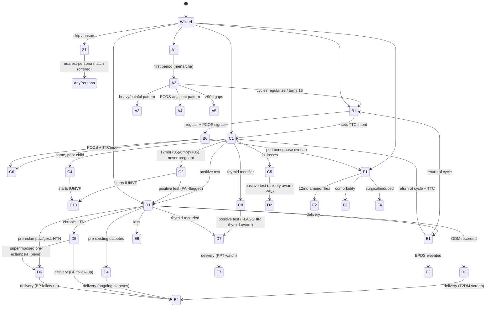

# Femio V2 — Master Adaptation Model
Prepared: 2026-07-16 · Status: living spec · Synthesized from the 16 Wave-1+2 persona specs in `docs/personas/`
Companion to: `08_PERSONA_TAXONOMY_AND_ADAPTIVE_UX.md`

This is the **brain**: the single logic layer that turns wizard answers and live user events into a personalized app state, and moves a user between states as her life and health change — without ever rebuilding her record, hiding knowledge, or diagnosing. Every rule here is generalized from patterns that recurred across all 16 personas, so the remaining ~54 personas plug into it rather than reinventing it.

---

## 1. Seven invariants (every persona obeyed these — they are now global law)

1. **Personalize, never restrict.** The resolver changes *emphasis, defaults, tone, and alerts* — never *access*. Every article/tool stays reachable via search/library from any state. Teen/minor mode is the only place anything is truly gated (community/DMs/UGC, for safeguarding), and that gates *social/data*, never *knowledge*.
2. **Constant EMR, additive layers.** One record spans her whole life. A transition **re-layers content + home config + alert logic over an unchanged core**; it never deletes or rebuilds. History is archived-but-reachable, never lost.
3. **Explicit, reversible confirmation.** Every mode switch is offered, confirmed by the user, and reversible. Nothing is forced. She can edit or reset her state anytime (wizard is re-openable in settings).
4. **Never diagnose, treat, prevent, or contracept.** Femio surfaces education + tracking + "discuss with your clinician." Screeners = screening. Thresholds (12-mo TTC, TSH bands, BP ≥160/110) are *educational routing/awareness*, never verdicts. Medication content is educational, never a dose.
5. **Uncertainty-honest.** Predictions are ranges + confidence, never single certain dates. In irregular states (PCOS, perimenopause, adolescence) prediction UI degrades gracefully to trend + "this is expected," and never shows a "late" counter.
6. **Privacy-by-design.** Health data is special-category: explicit granular consent, no ad/analytics-SDK access, no employer/insurer visibility, partner-sharing is scoped + revocable, data export/delete. Every transition that exposes a new data class re-confirms sharing scope.
7. **Emotional safety by default.** Loss instantly suppresses celebratory/milestone reminders. Tone avoids both doom and toxic positivity. Silence-over-risk on grief paths. Crisis resources on any high mood-screen.

---

## 2. The state object

Every user is described at all times by one resolved state:

```
UserState {
  track:            A | B | C | D | E | F | Z        // life-stage spine
  persona_id:       e.g. "D7"                         // resolved primary persona
  modifiers[]:      e.g. [thyroid, pregnancy_after_loss]   // stackable condition/context layers
  emotional_context[]: e.g. [prior_loss, high_anxiety, waiting]
  flags:            { minor_tier, ttc_intent, pregnant, high_risk, gentle_mode, ... }
  gestational_or_cycle_clock: EDD | gynecologic_age | postpartum_week | ttc_start_date | last_bleed
  confidence:       resolver confidence (drives Z-fallback blending)
}
```

The state drives five outputs, and **only** these five (never access):

| Output | What it controls |
|---|---|
| **Home config** | Hero card + ordered module list + pinned tools |
| **Tools/logs** | Which trackers are surfaced (cycle, BBT/OPK, glucose, BP, TSH, EPDS…) |
| **Content library skin** | Which education is foregrounded; reading order; tone/reading-level |
| **Alert logic** | Reminder cadence, red-flag boxes, screening prompts |
| **EMR view** | Which persona-specific fields surface over the constant core |

---

## 3. Data model: constant core + persona layers

**Constant core (the one-account spine, present for everyone):**
`user_id · dob/age_band · locale · rtl_pref · consent_flags · account_mode` ·
`cycle{period_start/end, cycle_length_history[], flow[]}` · `symptoms[] · mood[] · meds_supplements[] · conditions_flagged[] (non-diagnostic)` · `content_history[] · screener_results[] (timestamped, non-diagnostic)` · privacy/state flags (minor_tier, ads_off, trusted_adult_link+scope).

**Persona layers (switched on additively, never replacing the core):**

| Layer | Adds (examples) |
|---|---|
| Adolescent (A) | gynecologic_age, menarche_status, pubertal_stage (self-report), trusted-adult scope, non-diagnostic timing-watch booleans |
| Cycle/gynae (B) | phenotype hints, hyperandrogenism/metabolic self-report, user-entered labs (no interpretation), amenorrhea counter, ttc_intent=false |
| TTC (C) | ttc_start_date, bbt/opk/cm logs, ovulation_confirmed, partner_link+scope, preconception_checklist, predicted_window{confidence} |
| Infertility (C2/C4/C5) | infertility_type, evaluation_phase, labs[] (entry-only), partner_semen_analysis, imaging_results, appointments[], workup_roadmap, loss_count, key_dates |
| Pregnancy (D) | EDD, gestational_age, complication flags, red-flag contacts; **+condition sub-layers**: glucose[] (D3/D4), BP[] (D5/D6), thyroid labs+dose_change_history (D7), all entry-only |
| Postpartum (E) | postpartum_week, EPDS history, carried complication flags (→E4), lactation/return-of-cycle |
| Menopause (F) | STRAW+10 stage hint, MRS history, symptom log (34+), HRT/MHT log (educational) |

Rule: a persona-specific field is **surfaced or hidden**, never destroyed. Dropping a layer (e.g. exiting pregnancy) archives it, reachable on return.

---

## 4. The welcome wizard (editable + resettable)

A short branching questionnaire that resolves the initial state. Re-openable anytime from Settings → "Edit or reset my experience" (satisfies your requirement). Always offers **"Skip / I'm not sure" → Z1**.

Resolution spine (first matching branch wins; modifiers stack):

```
Q1 Life stage?
 ├─ "Learning about my body / not started periods"  → A1  (minor tier ON)
 ├─ "Recently started periods" (age 12–15)          → A2  (minor tier ON)
 ├─ "Tracking my cycle / general"                   → B1  → refine by Q2
 ├─ "Trying to conceive"                            → C*  → refine by Q3
 ├─ "I'm pregnant"                                  → D*  → refine by Q4
 ├─ "I recently gave birth"                         → E*  → refine by Q5
 ├─ "Menopause / my cycles are changing (40s+)"     → F*  → refine by Q6
 └─ "Skip / not sure"                               → Z1  (generic, progressive)

Q2 (cycle) regular / irregular-or-absent / a condition I know of
      → irregular/absent → PCOS/irregular mode (B6…); condition → B7/B8/…
Q3 (TTC) how long trying? · ever pregnant? · age · known condition/loss? · partner factor?
      → C1 (default) | ≥12mo & <35 & never pregnant → C2 | prior child → C4 |
        ≥2 losses → C5 | PCOS → C6 | thyroid → C8 | in IVF/IUI → C10 …
Q4 (pregnant) any conditions your clinician is watching? (multi-select)
      → D1 (default) + additive D3/D4/D5/D6/D7/D9/D12/D13… ; prior loss → D2 tone
Q5 (postpartum) → E1 + carried complication flags → E4 ; mood → E3 watch ; feeding → E2
Q6 (menopause) symptoms · cycles stopped? · surgical/induced? · comorbidity?
      → F1 (peri) | 12mo amenorrhea → F2 | comorbid → F3 | surgical → F4
```

Every branch sets `minor_tier`, `ttc_intent`, `pregnant`, tone, locale/RTL, and prediction-UI mode accordingly. No branch removes library access.

---

## 5. The Z1 fallback resolver (your "Other/Custom" requirement)

Z1 guarantees **no user is ever blocked or frustrated by a missing persona.**

- **Entry:** "Skip / I'm not sure," a situation not covered by a defined persona, or low resolver confidence.
- **Default state:** the full generic experience — general cycle/wellness home, everything reachable, uncertainty-honest predictions, no condition assumptions.
- **Progressive personalization (nearest-persona resolver):** as she logs data, Z1 scores similarity to defined personas on the signals each persona keys on (age, cycle regularity, ttc_intent, pregnancy status, recorded conditions, symptom clusters, mood). When confidence crosses a threshold, Femio **offers** (never forces) the matching persona: *"Want me to tailor Femio for [situation]? You can undo this anytime."* Below threshold, it **blends** the two nearest personas' emphasis rather than committing.
- **Never a dead end:** if no persona fits, she stays in the rich generic experience permanently — that is a valid, first-class state, not a failure.

---

## 6. Universal events (global handlers — fire from almost any state)

These recurred in nearly every persona's §J, so they are defined **once** here and inherited everywhere:

| Event | Global handler | Typical route |
|---|---|---|
| **Positive pregnancy test** | Celebrate (tone-matched to history); suppress fertile-window/TWW/OPK/BBT; carry all data; re-confirm privacy scope; offer Pregnancy mode carrying active condition modifiers | → D-track, flagged with modifiers (thyroid→D7, PCOS→pregnancy+PCOS, after-loss→D2, after-infertility→PAI) |
| **Pregnancy loss / stillbirth** | **Instant** suppression of all milestone/celebratory/condition reminders; Gentle Mode; grief resources; retain data (incl. ongoing condition care like thyroid/diabetes); no re-prompting; date-control for anniversaries | → E6 grief, later optional C5/D2 (PAL) |
| **Mood screen high / crisis flag** | Surface mental-health module + localized crisis resources; screening framing; EPDS Q10 non-zero → immediate crisis path regardless of total | Stay + E3/support routing |
| **Red-flag symptom / severe reading** | Prominent "seek care now" box + saved emergency/maternity contact as *education*, never triage/diagnosis; log stays raw | Emergency messaging (content only) |
| **Disengagement / "taking a break"** | Pause all nudges; keep data; low-touch wellness content | Retain, silent |
| **Toggle mode off** | Revert to generic logic; preserve all history | → generic band / Z1 |
| **Age-of-consent milestone** | Re-confirm consent/privacy tier; relax minor gating per GDPR age-of-consent; knowledge access unchanged | Stay |

Persona §J tables now only need to specify their **persona-specific** transitions; universals are inherited.

---

## 7. Master state-transition graph



ASCII fallback of the spine:
`A1 → A2 → B1/B6 → C1 → {C2,C4,C5,C6,C8,C10} → D1 → {D3,D4,D5,D6,D7} → E1 → {E3,E4,E6,E7} ↺ B1/C1 … and B1/F1 → F2/F3/F4`. The **flagship** is the bold edge `C8 → D7` on positive test.

---

## 8. Modifier blending (multiple conditions at once)

Real users stack conditions. The resolver treats modifiers as **composable layers**, not exclusive states, with three rules:

1. **Union of safety layers.** All applicable red-flag sets are shown; overlapping ones (e.g. D5 chronic-HTN red-flags ⊇ D6 pre-eclampsia red-flags) are **merged, not double-counted**.
2. **Most-acute emphasis wins the hero.** e.g. pregnancy + thyroid + prior loss → hero = pregnancy timeline; strips = thyroid monitoring + PAL support; tone = anxiety-aware.
3. **Distinct paths stay distinct.** D3 (GDM, resolves postpartum → one-off OGTT) vs D4 (pre-existing diabetes, lifelong → ongoing E4) must never be conflated by the resolver — keyed on *diabetes-recorded-before-pregnancy*. Same care for A4/B6 PCOS screening vs label.

Worked blends already specified: `D5 ⊕ D6` (superimposed pre-eclampsia), `pregnancy ⊕ PCOS` (GDM-aware), `pregnancy ⊕ thyroid ⊕ PAL`, `PCOS ⊕ perimenopause` (symptom-overlap explainers).

---

## 9. Flagship worked example — C8 → D7 (reference implementation)

The canonical proof that one account adapts across life stages with zero data loss and full scope discipline:

1. **State before:** `track=C, persona=C8, modifiers=[thyroid], flags={ttc_intent:true}`. Home = fertile-window + TSH strip + med log.
2. **Event:** positive pregnancy test.
3. **Resolver:** fires universal *positive-test* handler → suppresses fertile-window/OPK/TWW/BBT; **keeps lab + medication logs running unchanged**; re-confirms privacy scope; offers one-tap switch.
4. **State after:** `track=D, persona=D7, modifiers=[thyroid], flags={pregnant:true}`. **Constant EMR untouched**; cycle history archived-but-reachable.
5. **Re-layer:** hero → pregnancy timeline + thyroid strip (latest TSH, next-lab reminder, med status); alerts → TSH-cadence reminders tighten to the guideline-described ~4-weekly pattern + a **medication-review-with-clinician** prompt; content → thyroid-in-pregnancy library skin.
6. **Guardrails held:** never a dose, never a TSH verdict; the early-pregnancy dose-increase teaching is framed as *what guidelines describe* + *"contact your clinician now."*
7. **Downstream:** delivery → E7 postpartum-thyroiditis watch; loss → E6 grief with thyroid care retained.

Every other life-stage adaptation in Femio is a specialization of this pattern.

---

## 10. What the remaining ~54 personas must supply (and what they inherit)

They **inherit**: the seven invariants (§1), the state object (§2), the constant core (§3), the universal events (§6), the Z1 fallback (§5), and blending rules (§8).

They only need to **add**: their persona-specific EMR fields, their home/tone config, their content skin, their red-flag set, and any **non-universal** transitions unique to them. This is why building the model from 16 first was worth it — Wave 3 now slots in at a fraction of the effort.

---

## 11. Open items for medical/compliance review (compiled from all 16 specs)

Every spec flagged `[NEEDS SOURCE]` items to verify before any content is user-facing — e.g. exact ACOG/NHS bleed-duration wording (A2), preconception TSH-target debate 2.5 vs 2.5–4.5 (C8/D7), IOM weight-gain bands (D1), GDM glucose thresholds by unit/region (D3), CHAP/ACOG BP treatment threshold (D5), aspirin dose EN vs NICE (D6), FTC primary docs (privacy claims), and per-locale (esp. Arabic/MENA) crisis directories and emergency numbers. These should be consolidated into a single reviewer checklist before Phase-1 content freeze.
```
