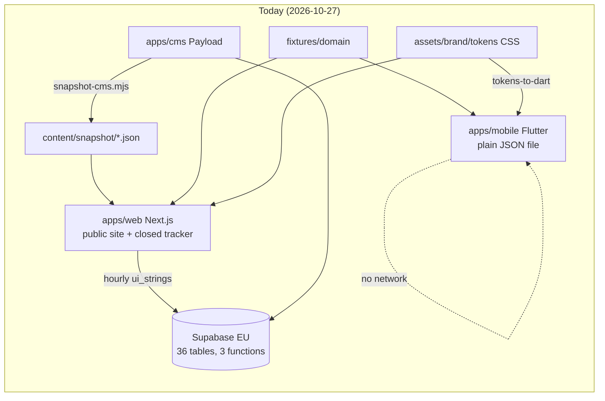
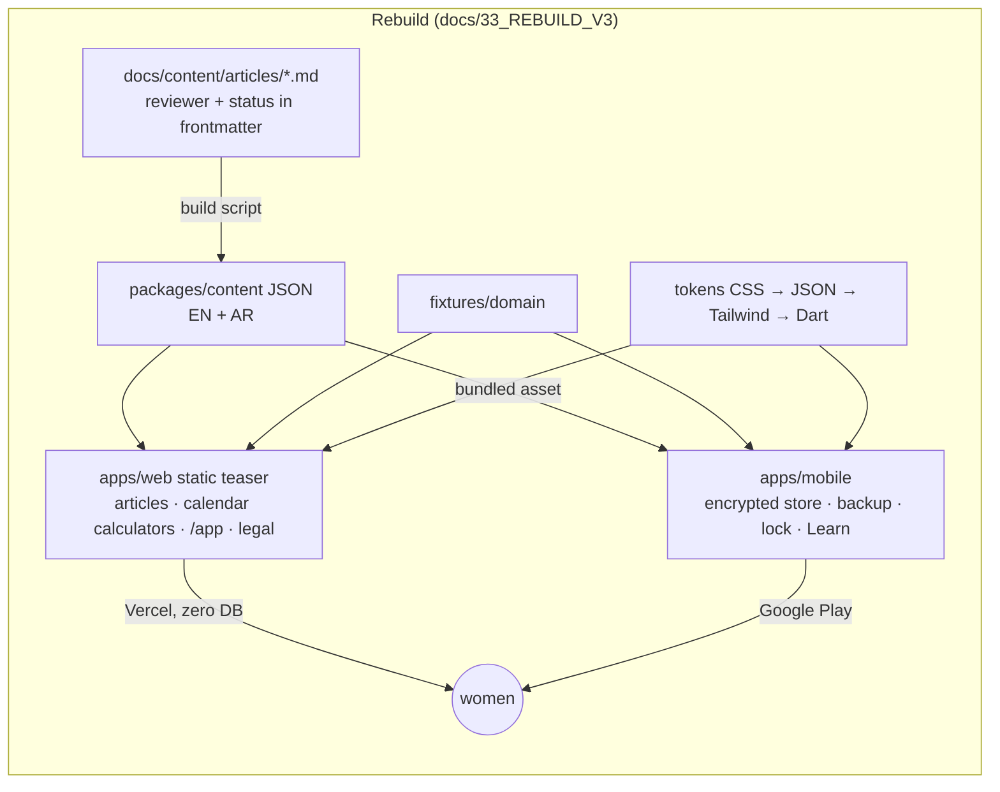

# 32 — The Femio study (2026-10-27): one picture

**What this is.** Twelve study agents read every part of the repository on 2026-10-27 (reports
`01`–`12` in `reports/`, one knowledge graph in `graph/femio-graph.json`, 1,066 nodes and
1,396 edges, drawn in `graph/index.html`). This page is the lead's synthesis: what Femio is, what
is sound, what is dead, and what the rebuild in `docs/33_REBUILD_V3/` rests on. Labels: **Checked**
= measured today; **From the docs** = the repo says so; **Hypothesis** = a reading of the evidence.

---

## 1 · Femio in one paragraph

Femio is a women's-health product by a Cairo physician: a **private Android app** (Flutter, records on
the phone, no accounts) for women **trying to conceive and then pregnant**, with **PCOS depth**,
**Arabic first**, aimed at **Saudi Arabia and Egypt**; and a **website** (`femioapp.com`, Next.js) that
carries **100 cited English articles**, 5 condition hubs and 7 calculators and sends people to the
app. Six product rules gate every feature: wellness only (never diagnose, treat or act as
contraception); personalise, never restrict; ranges + confidence, never a single date; privacy by
design; one constant record with additive layers; Arabic and RTL first-class with the English
wordmark **femio**. The design language is **Dusk Bloom** (plum, rose, peach, saffron, sage on warm
porcelain; Newsreader + Plus Jakarta Sans; Noto Naskh Arabic + IBM Plex Sans Arabic).

## 2 · What exists today (Checked)

| Part | Size | State |
|---|---|---|
| Website `apps/web` | 44,660 lines TS/TSX, 407 files | Live. 26 public routes. **19 closed tracker routes** still in the tree behind a flag. One Supabase read per non-English locale per hour (`ui_strings`). Build fails without Supabase env vars. |
| Android app `apps/mobile` | 10,519 lines Dart (≈3,100 hand-written), 41 files | v0.4. Onboarding (11 steps), Today, Calendar, Log, TTC toolkit, 4 pregnancy tools. `flutter analyze` clean, **61 tests pass** (Flutter 3.47.8, re-run today). Record is one **plaintext JSON file**; no backup, no lock, no reminders, no articles, no settings, debug signing key. |
| CMS `apps/cms` (Payload) | 25,095 lines | Still the editor; retirement decided (D3) not done. No tests. Production DB string in `.env.local`. |
| Database `supabase/` | 25 migrations, 3 edge functions, 36 tables | Everything but `ui_strings` serves the closed tracker. `predictions`, `experience_documents` never written. Project restricted (402) on the free plan. |
| Shared maths `fixtures/domain` | 12 JSON fixtures, 68 cases | TS runs 12, Dart runs 8. Persona/phase/signals/experience fixtures "not yet ported". |
| Content snapshot | 100 articles, 5 conditions, 1 author; **0 Arabic, 0 FR, 0 ES**, 0 FAQ, 0 glossary | 25 articles name a reviewer (the owner). 77 carry a red-flag box. Median 795 words, 3 citations. 13 pass all three mechanical checks; 11 of those are wedge topics. |
| Strings | Web 1,692 keys × 4 locales (72% belong to the closed tracker); app 247 keys × 4 | Parity perfect. Arabic is natural MSA. 9 gendered forms, 154 English em-dashes, one diagnostic word, one dangerous idiom ("ماء الرأس"). |
| Tokens | CSS canonical (297 names, 90 colours, dark) | JSON mirror stale; Tailwind preset still names Inter/Fraunces; Dart has colours only. Gate's two Dart checks fail on Windows CRLF only. |
| Brand assets | Dusk app icon (SVG + 512 PNG) | **Logo, web favicon and manifest are still the retired violet.** No favicon.ico, no PNG 16/32, no apple-touch-icon, no maskable 192/512, no OG image. |
| Docs | 299 files, 60,738 lines | Rich, but **41 contradictions** (report 09 §4); `CLAUDE.md` still describes the August web-first product. |
| Gate and CI | 17-step `pnpm gate`; CI runs 10 of 14 guards; **no Flutter step in the gate** | `ui_strings` and Supabase e2e tie CI to the live database. |
| Compliance | 54-item private-v1 checklist (report 10 App. A) | 9 done, 13 drafted, 32 missing. Privacy/terms describe the cloud product. No Egypt or Saudi crisis number anywhere. The app has no crisis route, no wellness disclaimer, no "not a method of birth control" sentence. |

## 3 · What is sound (keep)

1. **The product rules and the safety reasoning.** "Never a verdict" is implemented consistently in
   the domain code on both sides (movement log flags a change in her own pattern, contraction timer
   gives no labour verdict, screeners return totals with a separate self-harm flag). This is the
   asset.
2. **The Dart domain layer and its twin discipline.** `apps/mobile/lib/domain/*` is faithful to the TS,
   bound by shared fixtures, and reads well. Keep, extend fixtures, name constants.
3. **The content library.** 100 cited, structured articles in Lexical JSON with red-flag boxes; the
   Markdown drafts in `docs/content/articles/` are the long-term source. The `topics.ts` map encodes
   the wedge order (TTC → pregnancy → weeks → the rest).
4. **The public website's shell.** Header, footer, Learn hub, article template, calculators, static
   search index, SEO plumbing (sitemap, robots, JSON-LD, hreflang), crisis provider, CSP headers.
5. **The token system's canonical CSS** and the generators (`tokens-to-dart`, `sync-log-vocabulary`).
6. **The guards that catch real errors:** claims-lint, crisis-compliance, content-lint, untranslated
   lint, sitemap-check, golden fixtures.
7. **The persona specs** (73, schema A–K): C6 (TTC with PCOS), C1 (TTC), D1 (pregnancy), B6 (PCOS not
   TTC) are the wedge's requirements document.

## 4 · What is dead or wrong (remove or rebuild)

1. **The closed web tracker**: 19 routes, ~100 components (≈9,000 lines), 15 lib folders, 44 message
   namespaces (1,226 keys), 8 `@live` e2e specs, `@supabase/*`. Switched off in production since
   2026-10-07 but still built, bundled, tested and translated. Its ideas live in the docs and the
   Dart app; its TSX does not need to exist.
2. **Supabase at runtime and Payload.** One hourly `ui_strings` read keeps the website tied to a
   restricted database; the build cannot run without the keys. Retirement sequence: report 05 §10.2.
3. **The app's data layer.** Plaintext JSON, rewritten on every tap, silently overwritten if corrupt,
   no backup, no lock, `allowBackup` not set (Google may upload the record), debug signing.
4. **Brand surface.** Violet logo, violet favicon, violet manifest `theme_color #7C3AED`, no icon set,
   no OG image, iOS template icon, white splash.
5. **Legal and safety copy.** Privacy and terms describe accounts, teens and cloud encryption; the
   mandated fertility sentence and wellness disclaimer are absent; no local crisis numbers; three UI
   strings claim every guide is clinician-reviewed (false for 75).
6. **Documentation drift.** `CLAUDE.md`, `30_REVAMP/00_README`, `03_REVAMP_PLAN §2.3`, `docs/12`,
   `docs/14`, `docs/24` describe superseded directions. No ADR records D1–D6.
7. **Specific bugs found by reading** (not yet fixed; Hypothesis until reproduced): resolver symptom
   keys `hotFlushes`/`troubleSleeping` never written by the logger (web, dead with the tracker);
   calendar reads `predictions` with a `kind` the CHECK forbids (web, dead); `request.ts` returns
   `ar-u-nu-latn` as the locale so Arabic week-start may be wrong (web); "Start over" wipes the record
   with no confirmation (app); `movementsNeedMore` has no plural (app); fertile window for
   irregular/PCOS cycles is still "14 days before the predicted period" (app).

## 5 · The calculators, specifically (Checked on the live site at 390×844)

Dates are entered through the browser's native `<input type="date">` (`dd/mm/yyyy` with a tiny
calendar glyph) in all seven calculators, in English and Arabic. The result month view
(`MiniCalendar`) is display-only and `aria-hidden`. The owner's direction is an **interactive,
engaging, informative calendar** as the input itself (tap the day, see the window appear on the
same calendar), the way the best competitor pages work. That is a rebuild of the calculator
input layer, not of the maths (`lib/calculators/*` and `lib/pregnancy` stay).

## 6 · The twelve reports, one line each

| # | Area | Headline |
|---|---|---|
| 01 | Web engine | 23-rule persona resolver, ranges + confidence everywhere; port the pure logic to Dart, delete the server tier |
| 02 | Web platform | Tracker closed by flag not deletion; Supabase still required at build and hourly at runtime; icon set weak and violet |
| 03 | Web components | 121 files; public shell is good; ~100 files go with the tracker; native date inputs today |
| 04 | Mobile | Clean first build, 61 tests pass; data layer must be rebuilt (encryption, backup, lock); 3 files > 300 lines; medical rules in `today_screen.dart` |
| 05 | Data + CMS | Only `ui_strings` is live; 8-step retirement sequence; reviewer metadata exists only in the CMS |
| 06 | Tooling | 17-step gate, CI runs 10 of 14 guards, none for Flutter; two guards fail on CRLF; image-size exception overdue |
| 07 | Content | 100 EN / 0 AR; 13 articles pass all mechanical checks; PCOS depth and week-by-week not ready; Lexical JSON format |
| 08 | Strategy | Wedge and markets decided; one SWOT (Oct 2026); 29 contradictions, 36 unsourced claims; payments must be PayPal/Paddle/Play |
| 09 | Plans | Binding ledger D1–D8, ADR-060..071, OD-1..16; 41 contradictions; Dusk Bloom reference in §7; launch week of 30 Nov |
| 10 | Compliance | 54-item checklist: 9 done, 13 drafted, 32 missing; no crisis route in the app; policies describe the wrong product |
| 11 | Brand + personas | CSS canonical, other layers drift; no favicon set; logo still violet; C6/D1/C1/B6 specs define the wedge |
| 12 | i18n | 21 of 67 web namespaces survive a teaser; Arabic good MSA with an afternoon of fixes; wordmark spelling split |

## 7 · Architecture, as it is and as it will be

## 8 · Decisions this study makes (with defaults, per the owner's rule that every decision has one)

| # | Decision | Default taken | Why |
|---|---|---|---|
| S1 | Delete the closed web tracker, do not archive it in the tree | Delete (git history keeps it) | Dead weight in build, tests, strings and security surface |
| S2 | Supabase and Payload: retire | Export `ui_strings` diffs and the reviewer metadata into the repo, then remove every runtime dependency; pause the project | $0 running cost, no health data liability, no outage path |
| S3 | Content source of truth | Markdown in `docs/content/articles/` with frontmatter; a build script makes the JSON both apps read | One source, reviewable in a diff, no CMS |
| S4 | Calculators | Interactive calendar input + result on the same calendar, Hijri secondary label in Arabic later | Owner direction; competitor standard |
| S5 | App data layer | Encrypted file (AES-GCM, key in Android Keystore), serialised writes, corruption quarantine, user-saved backup, app lock | A private-records app without these loses her data or exposes it |
| S6 | Analytics on the teaser | None in v1 (Vercel's own aggregate analytics at most) | Nothing to consent to; nothing to register |
| S7 | Brand surface | Regenerate logo, favicon set, manifest, OG image, Android adaptive icon and splash from the Dusk icon source | One palette everywhere |
| S8 | Wordmark in Arabic prose | Latin **femio** always, also inside Arabic sentences | Rule 6 extended; the docs' split ends |
| S9 | Payments | None at launch; Google Play Billing when billing comes | Freemium decided; Egyptian seller cannot use Stripe |
| S10 | Legal pages | Rewritten for the on-device product from the published laws; the owner approves as owner | Owner direction 2026-10-27 |

Everything else (dates, scope lock, roles) is in `docs/33_REBUILD_V3/00_PLAN.md`.
