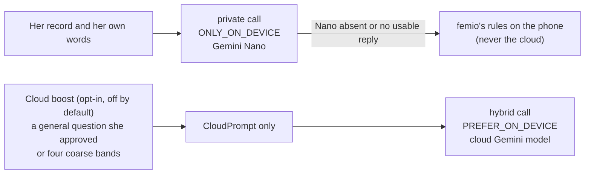

# femio: AI-assisted women's health and wellness (Android)

femio is a private companion for periods, trying to conceive, pregnancy, the year after birth and
menopause. Her record lives only on her phone: no account, no server, no analytics, no ads. This
repository is the Android app (Flutter + Kotlin), entered in Google's **#BuildHybridAI** hackathon.
It is wellness, education and tracking only: femio never diagnoses and is not a method of birth
control. Licence: [Apache-2.0](LICENSE).

## Hybrid AI: where each call runs

femio uses **Firebase AI Logic** with two kinds of call, chosen by how sensitive the input is:



| On the phone only: `InferenceMode.ONLY_ON_DEVICE` (Gemini Nano) | Cloud boost: `InferenceMode.PREFER_ON_DEVICE` |
|---|---|
| **Say it**: one note ("cramps since Monday, bad sleep last night") becomes draft log entries over one or several days; nothing is saved until she ticks the chips and taps Save | Only on a phone without Gemini Nano, and only after she agrees on the consent screen |
| **Ask femio**: Nano summarises passages from the bundled trusted-source library, even when the question is about her | **Ask femio**: a general question she has seen and approved, sent with the public passages it found |
| **Tips** and **visit questions**: Nano only puts femio's reviewed sentences in order | **Tips**: her four coarse bands, with every tip for her life stage (never the subset that fits her) |
| If Nano is absent, the feature runs on femio's rules on the phone. It never falls back to the cloud | Nothing from her log, notes or dates is ever part of a cloud prompt |

The model calls live in one Kotlin file,
[`FemioAssistant.kt`](apps/mobile/android/app/src/main/kotlin/com/femioapp/femio/assistant/FemioAssistant.kt):
`private` builds the model with `OnDeviceConfig(mode = InferenceMode.ONLY_ON_DEVICE)`, `hybrid` with
`InferenceMode.PREFER_ON_DEVICE`. Dart reaches it through one method channel
([`assistant_channel.dart`](apps/mobile/lib/data/assistant_channel.dart)) and one gateway
([`assistant_gateway.dart`](apps/mobile/lib/data/assistant_gateway.dart)), which waits at most
20 seconds and returns femio's rules answer on any failure. Each reply says where it ran
(`ON_DEVICE` or `IN_CLOUD`); a reply from a private call that did not run on the device is discarded.

## The privacy boundary, in code

- **One typed door to the cloud.** The cloud-capable call accepts only a `CloudPrompt`
  ([`cloud_prompt.dart`](apps/mobile/lib/domain/assistant/cloud_prompt.dart)). Its constructor is
  private and it has two factories: `CloudPrompt.answer(CloudSafeText, …)` and
  `CloudPrompt.tips(PseudonymisedProfile, …)`.
- **`CloudSafeText`** ([`redaction.dart`](apps/mobile/lib/domain/assistant/redaction.dart)) refuses
  a question written about herself (first-person words in four languages, such as "I", "my",
  "we", "عندي") and removes numbers, e-mail addresses and links. It does not detect names, so she
  sees the exact text in an editable box and approves it before anything is sent.
- **`PseudonymisedProfile`** ([`pseudonymised_profile.dart`](apps/mobile/lib/domain/assistant/pseudonymised_profile.dart))
  is four coarse bands: life stage, cycle regularity, kinds of symptom logged on two or more days
  in 30, logging streak. No dates, no free text, intimate terms excluded.
- **Recorded consent.** Cloud boost is off by default. The consent screen shows her own four bands,
  names Google as processor, and has one unticked box per purpose and an "I agree" button. Her
  choice is kept on the phone as a dated, versioned receipt, withdrawals included
  ([`cloud_consent.dart`](apps/mobile/lib/domain/assistant/cloud_consent.dart)); a new consent
  text version asks again.
- **Answers only from the bundled registry.** Ask femio searches
  [`assets/trusted_sources/registry.json`](apps/mobile/assets/trusted_sources/registry.json) on the
  phone: verbatim passages from US federal public-domain publishers (CDC, MedlinePlus, the Office
  on Women's Health, NIH institutes) and link-only further reading (WHO, NHS, ACOG, RCOG, NICE).
  The model may only summarise the passages and must cite them by number; a reply that cites
  nothing, or a passage that does not exist, is discarded and the passages are shown word for word
  (`parseAnswer` in [`prompts.dart`](apps/mobile/lib/domain/assistant/prompts.dart)). No passage, no
  answer: she sees "Not covered yet". No Google Search grounding and no tools are wired in.
- **Rules run before the model.** Red flags (for example heavy bleeding with dizziness, warning
  signs in pregnancy or the year after birth, thoughts of self-harm) open help, and birth-control
  questions get a fixed answer, before any model runs and again before a cloud send
  ([`safety.dart`](apps/mobile/lib/domain/assistant/safety.dart)).
- **She can check it.** Settings → Assistant → "What the AI can see" lists, for each AI feature,
  where it runs and exactly what it receives. "What the AI did" is a ledger, kept only on the
  phone, of every model call; for a Cloud boost call it keeps the exact text that was sent.
- **Every feature works with AI off.** Settings → Assistant → "Use the assistant" off: no model
  runs, on the phone or in the cloud, and every feature answers from femio's rules.
  `test/assistant_boundary_test.dart` runs every AI use against a failing bridge and with the AI
  off, fuzzes the reply parsers, and fails if the AI code imports her record store.
- **App Check on every call:** the debug provider in debug builds, Play Integrity in release
  (`android/app/src/{debug,release,profile}/…/AppCheckInstaller.kt`). femio adds no other Firebase
  product: no Analytics, Crashlytics, Messaging, Remote Config or Auth.

## The privacy tripwire (CI)

[`scripts/analytics-lint.mjs`](scripts/analytics-lint.mjs) is copied unchanged from femio's private
monorepo. In this repository it runs through [`scripts/privacy-tripwire.mjs`](scripts/privacy-tripwire.mjs),
which skips its website checks (the website is not published here) and fails on any app finding:
an analytics, ads or attribution package; network code (HTTP client, socket) in the Dart code;
Firebase outside the Kotlin assistant package or any Firebase library besides AI Logic and App
Check; the cloud call no longer requiring a `CloudPrompt`; a `CloudPrompt` built from anything but
`CloudSafeText` or `PseudonymisedProfile`; Google Search grounding; a model call outside the
gateway; an ad-ID or personal permission in the manifest. It is a CI check, not part of the
Android build. [`.github/workflows/ci.yml`](.github/workflows/ci.yml) runs it, a secret scan
([`scripts/secret-scan.mjs`](scripts/secret-scan.mjs)), `flutter analyze` and `flutter test` on
every push.

## Build and run

1. Flutter 3.47 or later, the Android SDK, JDK 17. Android 8.0 (API 26) or later.
2. Optional, for the AI: create a Firebase project with Firebase AI Logic (Gemini Developer API)
   and an Android app `com.femioapp.femio`. Copy `apps/mobile/assistant.env.example` to
   `apps/mobile/assistant.env` (git-ignored) and fill in the ids. Without it the assistant reports
   "not configured" and every feature runs on rules.
3. `cd apps/mobile && flutter pub get && flutter run`. In a debug build, register the App Check
   debug token printed in logcat in the Firebase console. Gemini Nano needs a phone with Android
   AICore support (Settings → Assistant shows its state and a Download button).

## Tests

```sh
cd apps/mobile
flutter analyze
flutter test
node ../../scripts/privacy-tripwire.mjs   # run from the repository root: cd ../.. first
```

`flutter test` runs the domain logic, the golden fixtures in [`fixtures/domain`](fixtures/domain)
(shared with femio's website), the assistant boundary and the widget tests. **Screenshot tests are
reported as skipped:** their reference images live in the private monorepo and were rendered on
Windows (see [`apps/mobile/dart_test.yaml`](apps/mobile/dart_test.yaml)). The export added the tag
`screenshots` to each test file that compares a screenshot; nothing else in the app was changed.

## What is here

- `apps/mobile/`: the app, exactly as committed in femio's monorepo (plus `dart_test.yaml` and the
  screenshot tags above).
- `fixtures/domain/`: shared golden fixtures for cycle and pregnancy maths.
- `scripts/`: the privacy tripwire, its wrapper and the secret scan.
- [`HISTORY.md`](HISTORY.md): this repository is a one-commit export of a private monorepo; that
  file lists the app commits made during the hackathon period, with dates and hashes.

Code comments cite decision numbers (for example ADR-079) from the monorepo's decision log, which
stays private: ADR-078 (the hybrid assistant), ADR-079 (registry answers and Cloud boost), ADR-080
(no app ads, recorded consent), ADR-081 (one gateway, typed prompts). This README states what they
decided.
